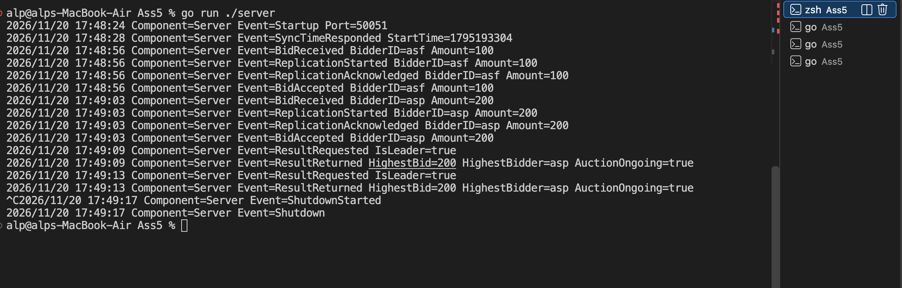
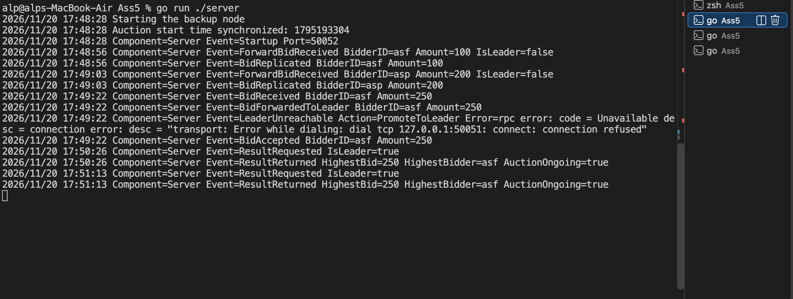
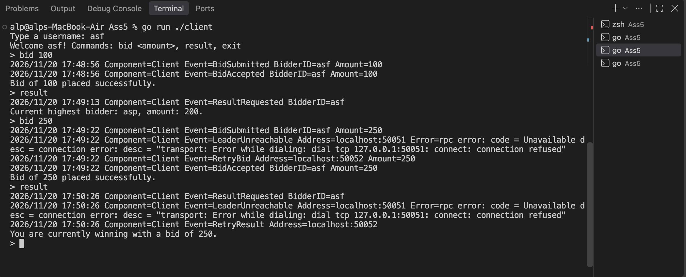
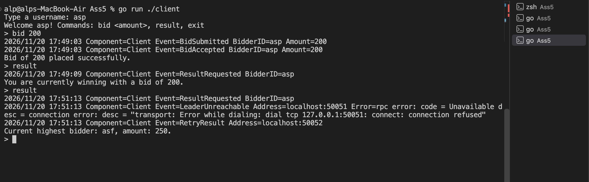

# Distributed Systems Mandatory Activity 5

A Go implementation of a distributed auction system using gRPC and primary-backup replication. Two server nodes maintain the auction state, allowing clients to place bids and query auction results. The system is designed to tolerate one crash failure.

## Prerequisites

- Go version specified in `go.mod`.
- Four terminals on the same machine: two servers and two clients.
- TCP ports 50051 and 50052 available.

Generated protobuf files are included in the `proto` directory, so `protoc` is not required to run the system. Go downloads dependencies on the first run if they are not already cached.

## Start the nodes

Open the `Ass5` directory in each terminal.

**Terminal 1 — Leader**

```sh
go run ./server
```

The first server binds to port 50051 and becomes the leader.

**Terminal 2 — Backup**

```sh
go run ./server
```

Since port 50051 is already occupied, the second server binds to port 50052 and becomes the backup node.

At startup, the backup synchronizes its auction start time with the leader using the `SyncTime` RPC. Both nodes use an auction duration of 1000 seconds.

Start the leader before the backup to allow successful time synchronization.

## Start the clients

Open the `Ass5` directory in two additional terminals.

**Terminal 3 — Client 1**

```sh
go run ./client
```

**Terminal 4 — Client 2**

```sh
go run ./client
```

Each client is prompted to enter a username, which identifies the bidder.

Available commands:

- `bid <amount>` — Submit a bid.
- `result` — Query the current highest bid or final auction result.
- `exit` — Close the client.

Bids must be positive integers and higher than the current highest bid. Bidders can submit multiple bids.

## Replication and concurrency

Clients can submit requests to either server node.

When the leader receives a bid, it validates the amount and auction deadline, forwards the bid to the backup using `ForwardBid`, and updates its local state after receiving the replication acknowledgement.

When the backup receives a client bid, it forwards the request to the leader using the same RPC. The leader processes the bid and replicates the accepted state back to the backup.

A separate mutex (`mu2`) serializes the leader's bid-processing workflow. Another mutex (`mu`) protects shared auction state.

For result queries, the leader returns its local state directly. The backup forwards result requests to the leader using `ForwardResult`.

## Failure behaviour

Each inter-node RPC has a 5-second deadline.

- **Backup failure:** The leader continues processing bids locally when replication fails with `Unavailable` or `DeadlineExceeded`.
- **Leader failure:** The backup promotes itself to leader after a failed forwarding request and continues processing bids using its replicated state.
- **Client failover:** If the client's initial server request fails due to a communication error, it retries through the backup server.

The implementation uses timeout-based failure detection rather than a complete consensus or leader-election protocol. Restart synchronization and recovery from inconsistent replica states are not fully supported.

## Run with the race detector

Start both server nodes using:

```sh
go run -race ./server
```

Start clients using:

```sh
go run -race ./client
```

## Logging

The servers produce structured logs showing incoming bids, forwarded requests, replication acknowledgements, accepted and rejected bids, result queries, auction expiration, and leadership changes.

Actual logs include date and time prefixes.

## Execution screenshots

The following screenshots show the execution of the distributed auction system, including the leader, backup, and two clients.

### Leader node

The leader processes auction requests, validates bids, and coordinates replication with the backup.



### Backup node

The backup receives replicated bids and synchronizes auction state with the leader.



### Client 1

Client 1 submits bids and queries the auction state.



### Client 2

Client 2 participates in the same auction, submitting bids and querying the highest bidder.



## Stop the system

Type `exit` to close each client, then press **Ctrl+C** in each server terminal.

The servers handle termination signals and attempt a graceful gRPC shutdown.
