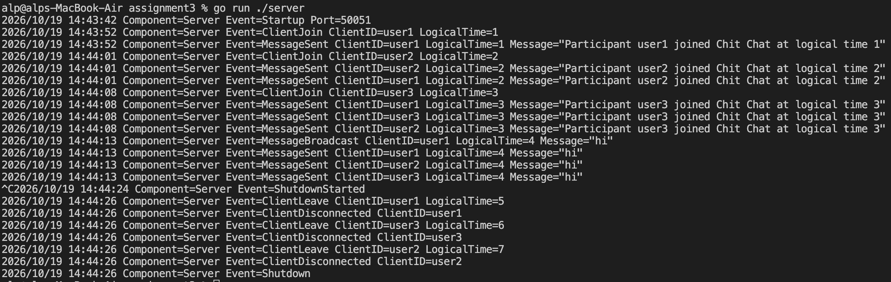
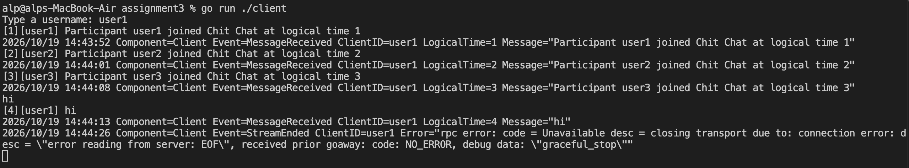

# Distributed Systems Assignment 3

To run the project, start the server first from the project root:

```sh
go run ./server
```

For the cleints, open a separate terminal for each client and run:

```sh
go run ./client
```

Enter a unique username, then type messages and press enter to send.

Type `/leave` to leave.


Server Logs


Client Logs
